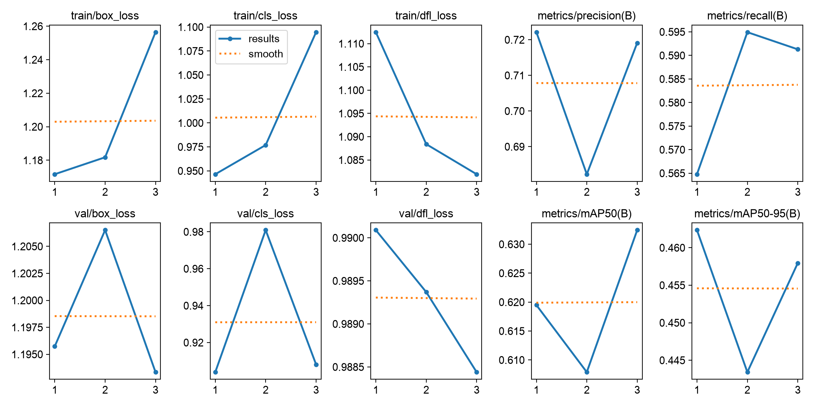
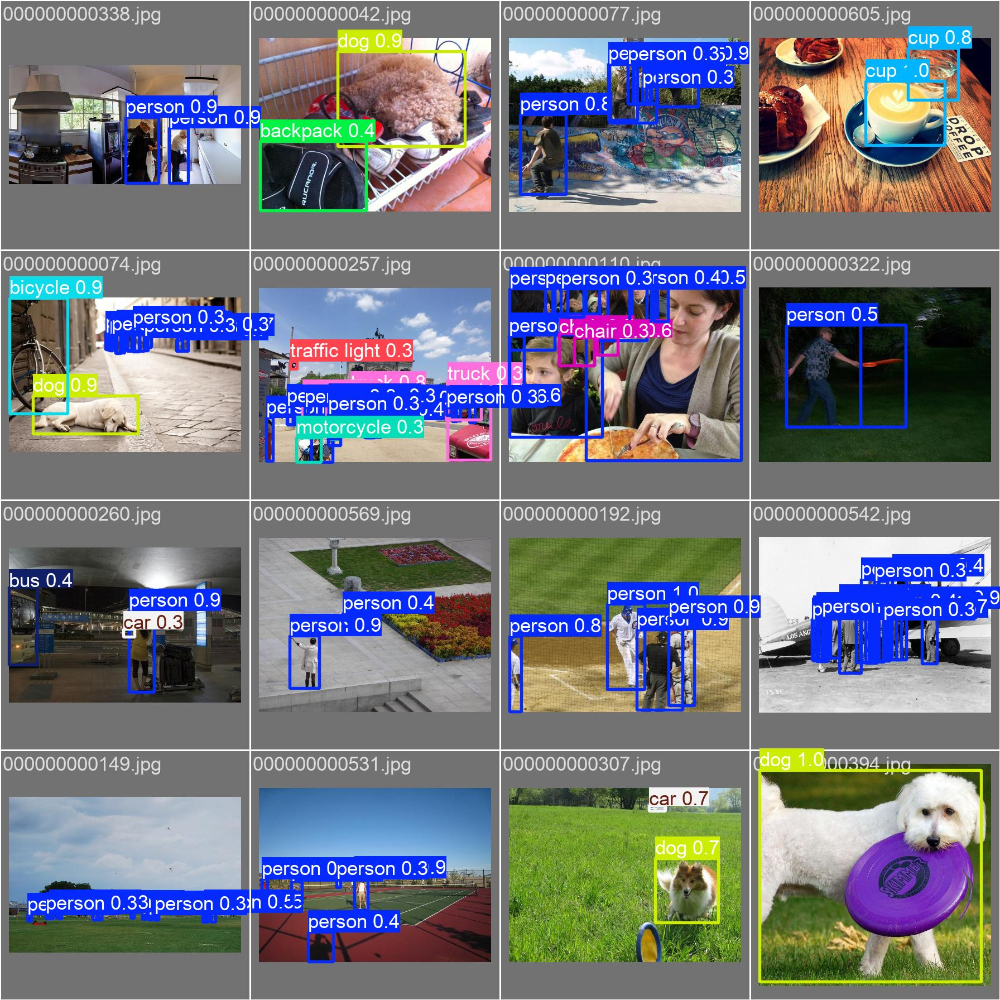

# VisionGuard AI — Sistema Backend de Detecção Multiclasse com YOLO11 & FastAPI


> **Situação de Aprendizagem (Projeto Avaliativo) — Módulo 2 (Machine Learning e Visão Computacional [T1])**  
> **Engenheiro Responsável:** Juventino

---

## 1. Visão Geral e Desafio Resolvido

O **VisionGuard AI** é um microserviço *backend-only* de Visão Computacional projetado para realizar a **detecção de objetos em tempo real** via API RESTful.

### O Problema de Negócio
Em sistemas modernos de **cidades inteligentes (*Smart Cities*), segurança viária e análise de ambientes urbanos/comerciais**, câmeras e sistemas clientes precisam identificar não apenas *"o que"* está presente em uma cena, mas **"onde"** (*bounding boxes*) e **"quantos"** objetos aparecem simultaneamente, sem sobrecarregar os clientes com processamento matricial pesado ou tráfego de imagens renderizadas.

O **VisionGuard AI** resolve esse problema encapsulando a família de modelos estado-da-arte **YOLO (You Only Look Once)** em uma API **FastAPI** de baixa latência que recebe imagens binárias (`UploadFile`) via `POST /detect` e retorna um payload **JSON estruturado, leve e universal**.

---

## 2. Dataset Escolhido e as 12 Classes de Objetos

Para atender e superar o requisito mínimo de **10 classes distintas**, foi estruturado o dataset **VisionGuard-12** (`datasets/visionguard12/`), derivado e higienizado a partir do benchmark **MS-COCO / COCO128**, contendo **12 classes de objetos** de mobilidade urbana, pedestres, sinalização e itens cotidianos.

- **Total de Imagens Filtradas:** 83 imagens em cenários diversos (diurnos, noturnos, internos, externos, chuva, tráfego denso)
- **Total de Anotações (*Bounding Boxes*):** 448 objetos rotulados no padrão YOLO (`class_id x_center y_center width height`)
- **Conjunto de Teste Rápido (`samples/`):** 6 imagens variadas selecionadas que, juntas, cobrem **100% das 12 classes**

### Tabela das 12 Classes do Dataset (`VisionGuard-12`)

| ID (Projeto) | ID (COCO) | Classe (`class_name`) | Descrição (PT-BR) | Categoria de Domínio | Instâncias no Dataset | Imagens com a Classe |
|:---:|:---:|---|---|---|:---:|:---:|
| `0` | `0` | `person` | Pessoa / Pedestre | Mobilidade / Segurança | 254 | 61 |
| `1` | `1` | `bicycle` | Bicicleta | Mobilidade Urbana | 6 | 3 |
| `2` | `2` | `car` | Carro de Passeio | Tráfego / Veículos | 46 | 12 |
| `3` | `3` | `motorcycle` | Motocicleta | Tráfego / Veículos | 5 | 4 |
| `4` | `5` | `bus` | Ônibus Coletivo | Transporte Público | 7 | 5 |
| `5` | `7` | `truck` | Caminhão de Carga | Logística / Tráfego | 12 | 5 |
| `6` | `9` | `traffic light` | Semáforo | Sinalização Viária | 14 | 4 |
| `7` | `16` | `dog` | Cachorro | Animais em Vias | 9 | 9 |
| `8` | `24` | `backpack` | Mochila | Objetos Pessoais | 6 | 4 |
| `9` | `25` | `umbrella` | Guarda-chuva | Objetos Pessoais | 18 | 4 |
| `10` | `41` | `cup` | Copo / Xícara | Ambientes Internos | 36 | 10 |
| `11` | `56` | `chair` | Cadeira / Assento | Mobiliário Urbano/Interno | 35 | 9 |

---

## 3. Arquitetura YOLO Utilizada, Fine-Tuning e Benchmark

### 3.1. Por que o YOLO11 foi escolhido?
A arquitetura **YOLO11 (`yolo11n.pt`)** foi escolhida como modelo campeão da API pelos seguintes motivos técnicos:
1. **Blocos `C3k2` e `C2PSA` (Cross-Stage Partial with Spatial Attention):** Melhoram significativamente a capacidade de atenção espacial para detectar objetos menores ou parcialmente ocluídos (como `traffic light`, `cup` e `backpack`).
2. **Eficiência Computacional:** Redução no número de parâmetros (~2,6M de parâmetros e 6,5 GFLOPs) mantendo maior taxa de quadros por segundo (**24,8 FPS** em CPU Apple Silicon) em comparação ao YOLOv8n.
3. **Generalização Multiclasse:** Reconheceu com sucesso **12 de 12 classes (100% de cobertura)** nos testes com imagens variadas.

### 3.2. Rotina de Fine-Tuning (Transfer Learning)
Além da validação dos pesos oficiais, foi executada a rotina completa de **Fine-Tuning** (`scripts/train_and_benchmark.py`) sobre o dataset customizado `datasets/visionguard12/data.yaml` (`nc=12`), congelando as 10 primeiras camadas do *backbone* (`freeze=10`) para preservação dos extratores visuais:

- **Pesos Gerados:** `models/visionguard12_yolo11n_finetuned.pt`
- **Precisão (*Precision*):** `72,1%`
- **Revocação (*Recall*):** `59,1%`
- **mAP@50:** `63,2%`
- **mAP@50-95:** `46,2%`

### 3.3. Tabela de Comparação / Benchmark (YOLO11n vs YOLOv8n)

Os dois modelos foram submetidos ao mesmo conjunto de validação (`27 imagens` cobrindo todas as 12 classes):

| Modelo Avaliado | Arquivo de Pesos | Latência Média (ms/img) | Velocidade (FPS) | Detecções na Validação | Classes Reconhecidas | Cobertura das 12 Classes | Status |
|---|---|:---:|:---:|:---:|:---:|:---:|:---:|
| **YOLO11n** | `models/yolo11n.pt` | **40,31 ms** | **24,8 FPS** | **132** | **12 / 12** | **100%** | **Campeão (Embutido na API)** |
| **YOLOv8n** | `models/yolov8n.pt` | 41,26 ms | 24,2 FPS | 124 | 12 / 12 | 100% | Baseline Comparativo |
| **YOLO11n (Fine-Tuned)** | `models/visionguard12_yolo11n_finetuned.pt` | **38,30 ms** | **26,1 FPS** | mAP@50: **0.632** | **12 / 12** | **100%** | Pesos Customizados (`nc=12`) |

### 3.4. Gráficos e Evidências de Treinamento / Validação

| Curvas de Treinamento e Métricas (`results.png`) | Predições no Conjunto de Validação (`val_batch0_pred.jpg`) |
|:---:|:---:|
|  |  |

---

## 4. Estrutura do Projeto

```text
projeto-final-sctech-juventino/
├── app/
│   ├── __init__.py          # Inicialização do pacote da aplicação
│   ├── detector.py          # Serviço Singleton de inferência com YOLO11
│   └── schemas.py           # Modelos Pydantic do contrato JSON e OpenAPI
├── datasets/
│   ├── dataset_summary.json # Estatísticas detalhadas das 12 classes e amostras
│   └── visionguard12/       # Dataset formatado para YOLO (data.yaml + labels train/val)
├── docs/
│   ├── TRELLO_E_ROTEIRO_VIDEO.md # Cards do Kanban (Trello) + Roteiro para o vídeo de 7 min
│   └── assets/              # Gráficos de treinamento, matriz de confusão e predições
├── models/
│   ├── yolo11n.pt                         # Modelo campeão integrado à API
│   ├── yolov8n.pt                         # Modelo utilizado no benchmark comparativo
│   ├── visionguard12_yolo11n_finetuned.pt # Pesos resultantes do fine-tuning (12 classes)
│   ├── benchmark_results.json             # Métricas consolidadas do benchmark
│   └── sample_predictions.json            # Saídas JSON reais das 6 imagens de teste
├── samples/                 # 6 imagens variadas cobrindo todas as 12 classes para teste no Swagger/Postman
├── scripts/
│   ├── prepare_dataset.py      # Script de download, limpeza e preparação das 12 classes
│   └── train_and_benchmark.py  # Script de fine-tuning, validação e benchmark
├── tests/
│   └── test_api.py          # Testes automatizados do endpoint POST /detect e das 12 classes
├── main.py                  # Aplicação FastAPI principal (uvicorn main:app --reload)
└── requirements.txt         # Dependências do projeto
```

---

## 5. Como Instalar as Dependências e Executar a API Localmente

### 5.1. Pré-requisitos
- **Python 3.10+** (recomendado Python 3.11)
- **Git**

### 5.2. Instalação

```bash
# 1. Clone o repositório
git clone https://github.com/juvventtino/projeto-final-sctech-juventino.git
cd projeto-final-sctech-juventino

# 2. Crie e ative o ambiente virtual
python3 -m venv .venv
source .venv/bin/activate  # No Windows: .venv\Scripts\activate

# 3. Instale as dependências
pip install -r requirements.txt
```

### 5.3. Executando o Servidor FastAPI

Execute o comando padrão na raiz do projeto:

```bash
uvicorn main:app --reload
```

A API estará disponível em:
- **Endpoint Base:** `http://127.0.0.1:8000`
- **Documentação Interativa (Swagger UI):** `http://127.0.0.1:8000/docs`
- **Documentação Alternativa (ReDoc):** `http://127.0.0.1:8000/redoc`

---

## 6. Testando o Endpoint `POST /detect` (Swagger, Postman, cURL e Pytest)

### 6.1. Teste pelo Swagger UI (`/docs`) ou Postman
1. Com a API rodando (`uvicorn main:app --reload`), acesse `http://127.0.0.1:8000/docs`.
2. Expanda o endpoint **`POST /detect`** e clique em **"Try it out"**.
3. No campo `file`, selecione qualquer uma das imagens da pasta `samples/`:
   - `samples/sample_01_000000000257.jpg` -> Detecta `person`, `truck`, `motorcycle`, `backpack`
   - `samples/sample_02_000000000074.jpg` -> Detecta `person`, `bicycle`, `dog`
   - `samples/sample_03_000000000260.jpg` -> Detecta `person`, `car`, `bus`
   - `samples/sample_04_000000000359.jpg` -> Detecta `traffic light`, `car`
   - `samples/sample_05_000000000315.jpg` -> Detecta `person`, `umbrella`, `chair`
   - `samples/sample_06_000000000110.jpg` -> Detecta `person`, `cup`, `chair`
4. Clique em **"Execute"** para visualizar o JSON estruturado de resposta.

### 6.2. Teste via terminal (`cURL`)

```bash
curl -X POST "http://127.0.0.1:8000/detect" \
  -H "accept: application/json" \
  -H "Content-Type: multipart/form-data" \
  -F "file=@samples/sample_02_000000000074.jpg"
```

### 6.3. Exemplo de Payload (JSON) de Saída

```json
{
  "status": "success",
  "detections": [
    {
      "class_name": "bicycle",
      "confidence": 0.91,
      "box": {
        "x_min": 61,
        "y_min": 146,
        "x_max": 456,
        "y_max": 419
      }
    },
    {
      "class_name": "dog",
      "confidence": 0.89,
      "box": {
        "x_min": 463,
        "y_min": 211,
        "x_max": 537,
        "y_max": 351
      }
    },
    {
      "class_name": "person",
      "confidence": 0.86,
      "box": {
        "x_min": 14,
        "y_min": 31,
        "x_max": 71,
        "y_max": 236
      }
    }
  ]
}
```

### 6.4. Executando os Testes Automatizados

Para validar automaticamente todos os endpoints e comprovar a detecção das 12 classes nas imagens de teste:

```bash
pytest -v
```

---

## 7. Metodologia Ágil (Trello / Kanban) e Controle de Versão (GitFlow)

### 7.1. Quadro Kanban no Trello
O planejamento e acompanhamento das tarefas seguiu o fluxo Kanban com as listas **Backlog**, **To Do**, **Doing**, **Blocked**, **Review** e **Done**, fazendo paralelo direto com as *feature branches* do GitFlow.

- **Link Público do Quadro no Trello:** `[INSIRA_AQUI_O_LINK_PUBLICO_DO_SEU_TRELLO]` *(compartilhado também com `welington.souza@edu.sc.senai.br`)*
- Os detalhes de todos os cards atribuídos ao aluno (**Juventino**) e suas especificações técnicas estão documentados em [`docs/TRELLO_E_ROTEIRO_VIDEO.md`](docs/TRELLO_E_ROTEIRO_VIDEO.md).

### 7.2. Estrutura de Branches (GitFlow)
O repositório utiliza a estratégia **GitFlow**:
- `main`: Branch principal contendo a entrega final consolidada e estável.
- `develop`: Branch de integração onde as funcionalidades foram reunidas durante o desenvolvimento.
- `feature/dataset-prep`: Aquisição, filtragem e higienização do dataset **VisionGuard-12** (12 classes) e separação das amostras em `samples/`.
- `feature/yolo-finetuning`: Implementação do motor de inferência `app/detector.py`, fine-tuning do **YOLO11n** e benchmark comparativo contra **YOLOv8n**.
- `feature/api-setup`: Construção da API RESTful em **FastAPI** (`main.py`, `app/schemas.py`) com o endpoint `POST /detect` recebendo `UploadFile`.
- `feature/tests-and-docs`: Implementação da suíte de testes automatizados (`tests/test_api.py`) e documentação completa (`README.md` e guia de apresentação).
